<!--
  hey, thanks for stopping by.
  the cat card is generated by scripts/generate_cat.py and refreshed daily by
  .github/workflows/cat.yml — edit the moods/cat art there, not in assets/cat.svg.
-->

<table>
  <tr>
    <td width="380" valign="top" align="center">
      
    </td>
    <td valign="top">
      <h3>hey, i'm Tamal 👋</h3>
      
Designer, developer and occasional gamer. I build small web things, break them, and then spend the evening fixing them.

      

        <strong>currently</strong> 
        📍 &nbsp;Pune, India 
        🛠 &nbsp;building <a href="https://github.com/tamalsamanta/multiplayer-wordle">multiplayer-wordle</a> &amp; <a href="https://github.com/tamalsamanta/shared-cart-extension">shared-cart-extension</a> 
        🌱 &nbsp;grinding competitive programming 
        💬 &nbsp;ask me about React, Node, Django or FPS games
      

      
<em>“Wish deployments were free :/”</em>

      

        
        
        
        
      

    </td>
  </tr>
</table>

### the stack

  
  
  
  
  
  
  
  
  
  

### things i've built

| project | what it is | stack |
| :-- | :-- | :-- |
| **[multiplayer-wordle](https://github.com/tamalsamanta/multiplayer-wordle)** | Wordle, but make that friend cry. | JavaScript |
| **[shared-cart-extension](https://github.com/tamalsamanta/shared-cart-extension)** | A browser extension for shopping online with friends. | JavaScript |
| **[zoom-clone](https://github.com/tamalsamanta/zoom-clone)** | A Zoom clone built on WebRTC and Socket.IO. | JavaScript |
| **[CompetitiveCoding](https://github.com/tamalsamanta/CompetitiveCoding)** | C++ solutions, and a contribution streak I refuse to break. | C++ |

### numbers

  
  
  

the cat redraws itself every night at 04:17 UTC, picks a new mood, and checks the stats. see <a href="./scripts/generate_cat.py">scripts/generate_cat.py</a> if you want to teach it new tricks.
